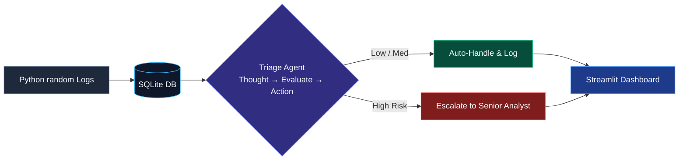

## AI SOC Alert Triage Agent

**Live Dashboard:**  [Dashboard 🚀](https://ai-soc-copilot.streamlit.app/)

A Security Operations Center (SOC) alert triage prototype built to help reduce analyst alert fatigue. The tool generates simulated security alerts, sorts them by severity using a *Thought -> Evaluate -> Action* loop, handles low- and medium-risk events automatically, and escalates high-risk threats to senior analysts through a live dashboard.


### ⚙️ Working



### ⚡ Quick Overview

1. **🎲 Generate Alerts:** A simulator uses Python's `random` module to create sample security events (such as unusual logins, port scans, and malware flags) so the workflow can be tested without live company data.
2. **🧠 Triage & Escalate:** The agent inspects each alert, assigns a severity level (`Low`, `Medium`, or `High`), resolves routine alerts on its own, and flags high-risk alerts for senior analysts, keeping simulated response times under **30 minutes**.
3. **📊 Store & Display:** All alerts, severity tags, and statuses are saved in a local SQLite database and shown in an interactive Streamlit dashboard.

---

### 📁 Project Structure

```text
ai-soc-triage-agent/
├── app.py               # Main Streamlit dashboard and user interface
├── agent.py             # Brain of the project (Triage logic: Thought -> Evaluate -> Action loop)
├── database.py          # SQLite setup and alert storage functions
├── requirements.txt     # Python libraries needed to run the project
└── README.md            # Project overview and setup instructions

```

---

### 🛠️ Tools & Requirements

* **Python:** `3.10` or higher
* **Streamlit:** Web dashboard interface
* **SQLite (`sqlite3`):** Built-in Python database for storing alert logs
* **Python `random` module:** Built-in library used to simulate incoming security logs

---

### 💻 Installation Guide
1. **Download the project:**
```bash
git clone [https://github.com/ImZb22/ai-soc-triage-agent.git](https://github.com/ImZb22/ai-soc-triage-agent.git)
cd ai-soc-triage-agent

```

2. **Install the required packages:**
```bash
pip install -r requirements.txt

```

3. **Start the app:**
```bash
streamlit run app.py

```

---

### 📝 Notes and Future Improvements

* **Simulated Data:** All security events in this project are randomly generated for demonstration and testing purposes.
* **LLM Reasoning Step:** Integrate a lightweight LLM API (such as Gemini or Groq) into the evaluation step to generate plain-English threat summaries and remediation steps for escalated alerts.
* **Accuracy Benchmarking:** Evaluate classification precision and critical-threat recall against a labeled ground-truth dataset of historical SOC logs.
